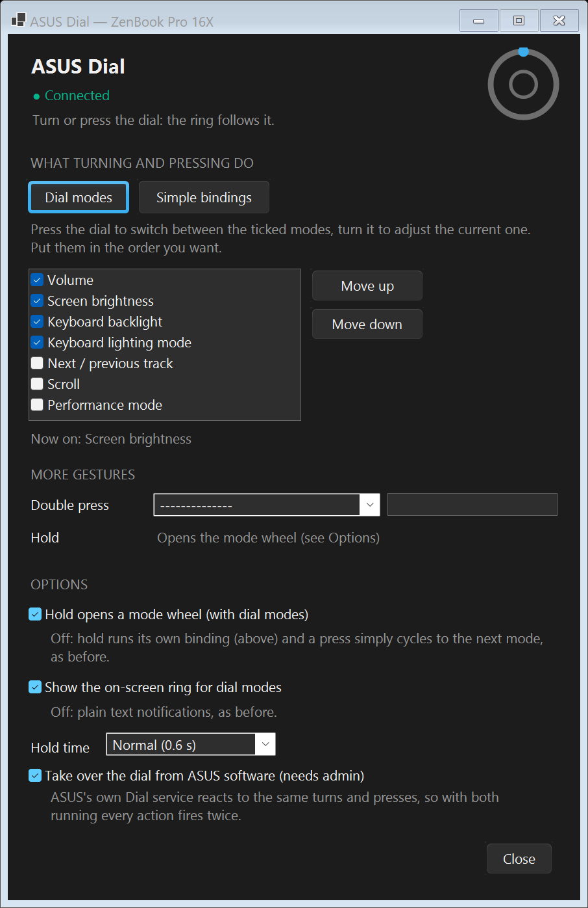
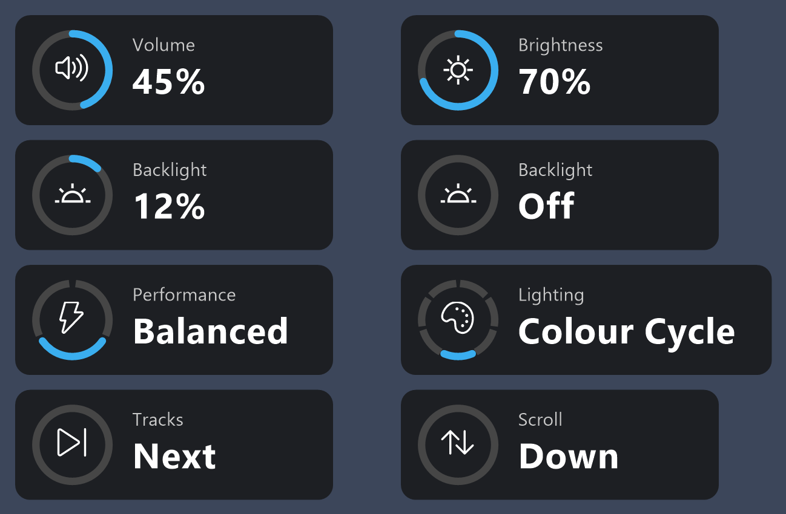
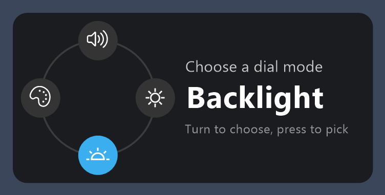
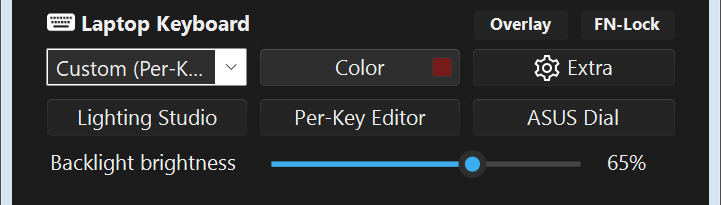

# G-Helper for the ASUS ZenBook Pro 16X OLED (UX7602)

The ZenBook Pro 16X OLED, with the ASUS Dial in the palm rest below the keyboard. Photo: [Laptop Mag's review](https://www.laptopmag.com/reviews/asus-zenbook-pro-16x-oled-ux7602z-review).

A fork of [G-Helper](https://github.com/seerge/g-helper) that adds control of the hardware on the
**ASUS ZenBook Pro 16X OLED (UX7602BZ / UX7602ZM)** that the stock app doesn't support: the keyboard
backlight and per-key RGB, the side lightbars and lid logo, brightness controls, and the **ASUS Dial**.

G-Helper is [Seerge's](https://github.com/seerge) project and all credit for the app itself goes to
the original: for everything else it does (performance modes, GPU modes, fan curves, updates and so on)
see the [original repository](https://github.com/seerge/g-helper) and its
[wiki](https://github.com/seerge/g-helper/wiki). The unmodified upstream readme is kept in
[`docs/README.md`](docs/README.md). This fork is not affiliated with or endorsed by the original
project or by ASUS.

**Download:** [Releases](https://github.com/HazzJC/g-helper-ZenBookPro16X-UX7602/releases). A single
`GHelper.exe`; run it as administrator if you want the dial takeover below.

## What this fork adds

Found by live hardware testing and by reverse-engineering ASUS's own MyASUS software:

- **Keyboard backlight brightness**: smooth dimming from off to full (see below), not just the four hardware levels
- **A per-key lighting editor**: a top-down view of the keyboard where you click or drag to paint
  individual keys, both side lightbars and the lid logo, with named profiles you can switch
  between. Opens from the **Per-Key Lighting** button next to the keyboard mode dropdown.
- **The lid logo in full RGB**: it's an addressable LED on the same bus as the keys, not the
  on/off ACPI toggle it was assumed to be
- **Hardware lighting effects**: Static, Breathing, Color Cycle, Rainbow, Strobe, Raindrop, Flash
- **Colour Rain**: a multi-coloured per-key effect built on a small animation framework, so
  further effects are a subclass and a few lines of wiring for future work 
- **Software-driven effects**: Heatmap, GPU Mode, Ambient, Battery, Audio Spectrum, Audio Pulse,
  Gradient and Zone Test
- **Animated per-key effects**: Aurora, Lava, Sonar, Fireflies and Ember, each with its own palette
  and speed
- **Keyboard brightness, one slider**: *Backlight brightness* in the main window, 0 (off) to 100 %, going
  far dimmer than the four hardware levels allow, with 1 % still visible and smooth fades. Also on the dial.
- **Lighting Studio**: every keyboard mode in one grouped list: show or hide each one in the
  keyboard dropdown and tune the colour-driven presets
- **The ASUS Dial**: its own settings window, dial modes (press to switch what turning does: volume →
  brightness → keyboard backlight …), an on-screen ring showing the value, and a hold-to-pick mode wheel.
  See below.

All of it is gated behind detection of this specific laptop model, so it has no effect on any
other supported device. 

### :control_knobs: ASUS Dial

The dial is a touch ring with a centre button. G-Helper reads it directly (read-only). Its settings are in
their own window: **Laptop Keyboard → ASUS Dial** in the main window.

- **Dial modes**: tick the modes you want and put them in order. A press switches mode, turning adjusts
  the current one: Volume, Screen brightness, Keyboard backlight, Next / previous track, Scroll,
  Performance mode, Keyboard lighting mode. Volume (2 %) and screen brightness (5 %) are set directly, so
  steps are exact.
- **Simple bindings**: instead of modes, turn right / left and press run any G-Helper action (volume,
  brightness, backlight, performance mode, lighting mode, mute, play/pause, tracks, scroll, a custom
  command, …). Double press and hold are bindable either way.
- **On-screen ring**: while using dial modes, the mode's icon sits in a ring showing its value (or which
  of a few states it's in). Optional; off shows plain text notifications.

  

- **Mode wheel**: hold the dial to see every mode at once, turn to choose, press to pick (3 s without
  input cancels). Optional; off, hold runs its own binding and a press simply cycles modes.

  

- **Live status**: the window shows whether the dial is connected, and a small ring follows the real
  dial as you turn and press it.
- **Take over from ASUS software**: ASUS's own Dial service acts on the same turns and presses, so with
  both running every action fires twice. This stops and disables only `ASUSDialService`; un-ticking it
  restores the service. It needs G-Helper to run as administrator.

The dial reports in a vendor mode that the hardware resets to the Windows default after sleep; G-Helper
sets it back on resume and re-checks every few seconds, so it keeps working across sleep.

Details: [`docs/UX7602-DIAL.md`](docs/UX7602-DIAL.md) covers the HID layout, the report formats, the
feature-report protocol (interface register, loopback) and what is and isn't known. A small HID
probe for experimenting lives in [`dialprobe`](dialprobe).

### :high_brightness: Keyboard brightness

The keyboard's hardware brightness only has four steps (off and three levels, and level 1 is still
fairly bright). G-Helper scales the colours it sends on top, so one slider covers everything from off to
full, and far dimmer than the hardware allows.

- **One slider**: *Backlight brightness* in the main window, 0 = off. The hardware level is handled
  automatically (level 3, where the range is finest). The dial's **Keyboard backlight** mode moves the same
  value, finely at the dim end (1 % per click up to about 12 %) and easing off towards the top.
- **1 % is always visible** as a very dim glow, in white and in saturated colours alike.
- **Smooth and flicker-free**: changes fade over about 120 ms and the idle timeout fades out and back in;
  a change only alters colour values, it never blanks or restarts the keyboard.
- **Firmware effects** (Rainbow, Colour Cycle, Rain) choose their own colours, so by default the slider moves
  them through the four hardware steps. *Extra → Laptop Backlight → Smooth dimming for Rainbow and Colour
  Cycle* draws those two in G-Helper instead, so they dim fully (they then stop when G-Helper is closed).
- **Stop MyASUS lighting agent** (Extra → Laptop Backlight): MyASUS's `AsusExclusiveAgent` re-applies
  ASUS's saved effect whenever the backlight changes (for example Fn+F7), overwriting G-Helper's lighting.
  This option keeps that one process stopped.

How it was measured, and why the curve looks the way it does:
[`docs/UX7602-LIGHTING.md`](docs/UX7602-LIGHTING.md#brightness-what-the-hardware-actually-does-2026-10-17-observed-live).

**Note on a crash seen once:** a bluescreen (`0x10E`, inside Windows' video memory manager) happened about
two seconds after G-Helper started its NVIDIA GPU initialisation, a few minutes after the laptop woke
from a long sleep. The crash dump contains no G-Helper code, so the cause is unproven; as a precaution,
if G-Helper is *started* within 10 minutes of a resume, its first contact with the GPU is delayed by 30
seconds (`gpu_resume_guard`, `gpu_resume_window_min`, `gpu_resume_delay` in the config).

## Documentation

- [`docs/UX7602-LIGHTING.md`](docs/UX7602-LIGHTING.md): the reference: HID topology, every command on
  report `0x5C`, the full LED slot map, and how it maps onto the code
- [`HANDOVER.md`](HANDOVER.md): what's confirmed working, what isn't, what changed and why,
  and the compatibility risk for other UX7602 variants
- [`FINDINGS.md`](FINDINGS.md): working notes, reverse-engineering tooling, and the approaches
  that were tried and abandoned

This has only ever been tested on one physical unit (`UX7602BZ`, firmware `X7602BZ.100`). Claims
in those documents are labelled by how they were actually verified, mostly by watching the
physical keyboard respond to one isolated command at a time.

## Credits and licence

- [seerge/g-helper](https://github.com/seerge/g-helper): the app this is built on, and the source of the
  libraries and projects it credits (see the [upstream readme](docs/README.md#libraries-and-projects-used)).
- Laptop photo above: [Laptop Mag](https://www.laptopmag.com/reviews/asus-zenbook-pro-16x-oled-ux7602z-review),
  linked rather than copied into this repository; all rights belong to its owner.
- Licensed under the GNU GPL v3, as the original; see [`LICENSE`](LICENSE).

"Asus", "ZenBook", "ROG", "TUF", "MyASUS" and "Armoury Crate" are trademarks of AsusTek Computer, Inc.,
used here only to identify the hardware. THE SOFTWARE IS PROVIDED "AS IS", WITHOUT WARRANTY OF ANY KIND.
Misuse of this software could cause system instability or malfunction.
