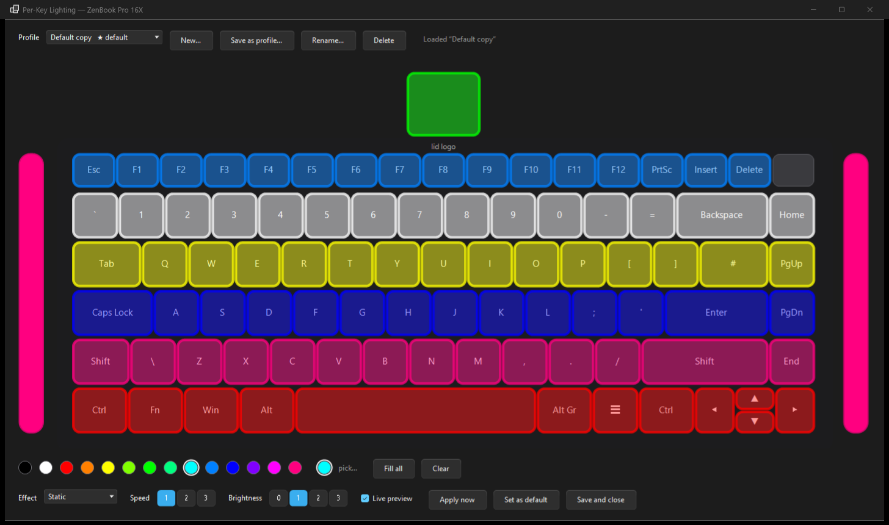

# G-Helper 16X

**Keyboard lighting for the ASUS ZenBook Pro 16X OLED (UX7602)** — a fork of
[seerge/g-helper](https://github.com/seerge/g-helper) that adds per-key RGB, both side lightbars
and the lid logo to a laptop upstream doesn't light.

[**⬇ Download the latest release**](https://github.com/HazzJC/g-helper-16x/releases/latest)



---

## Why this fork exists

The UX7602's keyboard is a per-key RGB panel with two side lightbars and an RGB lid logo, and
nothing outside MyASUS could drive it.

Upstream G-Helper couldn't either, for a specific reason: its `IsVivoZenPro()` check matches any
model containing `"Zenbook"`, and `IsDynamicLightingOnly()` separately matches any model
containing `"UX760"`. Both are true of a `UX7602BZ`, so the app treated the laptop as an ACPI-only
device driven by Windows Dynamic Lighting and never opened the USB HID interface the keyboard
actually listens on.

Getting past that was the easy part. The protocol itself had to be reverse engineered from the
hardware and from ASUS's own shipped binaries — see [the documentation](#documentation).

## What it adds

| | |
|---|---|
| **Per-key editor** | Click or drag on a top-down picture of your keyboard to paint individual keys. Named profiles, a palette and colour picker, live preview. |
| **Side lightbars** | Both bars, independently coloured. |
| **Lid logo** | Full RGB, painted like any other key. |
| **Brightness** | Four real dimming levels (0–3), not just on/off. |
| **Hardware effects** | Static, Breathing, Color Cycle, Rainbow, Raindrop, Strobe, Flash — rendered by the keyboard's own controller. |
| **Colour Rain** | Multi-coloured drops falling down the keys, splashing the lightbars. |
| **Profile animations** | Breathe, Strobe or Sweep applied to a layout you painted — they change only its brightness, so your colours stay recognisable. |

Everything is gated behind a model check, so this build behaves exactly like upstream G-Helper on
any other laptop.

## Install

1. Download **GHelper.exe** from [the latest release](https://github.com/HazzJC/g-helper-16x/releases/latest).
2. Run it. There's no installer, and nothing is written into your system beyond its own config.

Needs the .NET 10 desktop runtime, same as upstream.

> **The binary is unsigned.** Upstream signs theirs with a certificate this fork doesn't have, so
> SmartScreen will warn the first time ("More info" → "Run anyway"). If you'd rather not trust a
> binary from a fork, build it yourself:
> ```
> dotnet publish app/GHelper.sln -c Release -r win-x64 -p:PublishSingleFile=true --no-self-contained
> ```

## Using the per-key editor

Open G-Helper and click **Per-Key Lighting**, next to the keyboard mode dropdown.

- **Click or drag** a key to paint it; **right-click** to clear it. The lightbars and the lid logo
  are painted the same way.
- **Profiles** are saved as you go. **Save as profile…** takes a copy under a new name and can
  make it the default in one step.
- The **default** profile — marked ★ — is what your keyboard shows in *Custom (Per-Key)* mode.
  It only changes when you say so, so browsing profiles in the editor never changes your lighting
  by accident. Closing with **Save and close** makes the open profile the default; closing any
  other way puts your previous lighting back.
- **Effect** animates the layout you painted; **Speed** is 1–3 and **Brightness** 0–3, matching
  the keyboard's own steps.

## Known limitations

- **Tested on exactly one machine**: a `UX7602BZ` on firmware `X7602BZ.100`. The model check is a
  plain `"UX7602"` substring match with no capability probing, so a `UX7602ZM` or a different
  firmware revision would get the same commands, with unknown results.
- **The side lightbars are one LED each** — a gradient along a bar isn't possible.
- `Star`, `Highlight`, `Laser`, `Ripple` and `Comet` do nothing on this firmware, so they're
  hidden rather than shown as broken options.
- **MyASUS fights this app.** Its `AsusExclusiveAgent.exe` continuously re-streams its own
  lighting. Close MyASUS if your lighting keeps reverting.
- The binary is unsigned (above).

### Not implemented yet

G-Helper's software-driven modes — Heatmap, GPU Mode, Ambient, Battery, Audio Spectrum, Audio
Pulse, Gradient and Zone Test — are hidden on this model until each is built for it. GPU Mode and
Battery need the most work: they bypass the per-key path entirely and send a command meant for ROG
Strix keyboards, which this one doesn't accept. Per-mode status is in
[`FINDINGS.md`](FINDINGS.md).

## Documentation

The protocol isn't published by ASUS, so it's all written down:

- **[`docs/UX7602-LIGHTING.md`](docs/UX7602-LIGHTING.md)** — the reference. HID topology, every
  command on report `0x5C`, the complete LED slot map, and how it maps onto the code.
- **[`HANDOVER.md`](HANDOVER.md)** — what's confirmed working, what isn't, what changed relative
  to upstream, and the compatibility risk for other UX7602 variants.
- **[`FINDINGS.md`](FINDINGS.md)** — working notes, the reverse-engineering tooling, and the
  approaches that were tried and abandoned.

Claims in those documents are labelled by how they were actually verified. Most were confirmed by
watching the physical keyboard respond to one isolated command at a time — a standard worth
keeping, because an early pass on this fork shipped a "verified" checklist that had never been run
and one of its guesses actively broke the feature.

A couple of findings worth knowing if you're poking at this hardware yourself:

- The LED index space is a row-major matrix with a stride of 21: `slot = row * 21 + column`.
- The lid logo is **slot 0** of that same buffer, in full RGB — not the boolean ACPI call it was
  assumed to be.
- `[0x5C, 0xA2, 0x00, 0x00]` is an **enable** packet that must precede a streamed frame. Sent
  after the frame it blanks the keyboard; omitted entirely, host streaming silently does nothing
  unless ASUS's agent happens to have already put the controller into the right mode.

## Everything else

This is a complete G-Helper build — performance modes, GPU switching, fan curves, battery limits,
hotkeys and the rest all work as usual. For those, read
[the upstream documentation](https://github.com/seerge/g-helper) and
[wiki](https://github.com/seerge/g-helper/wiki); the upstream readme is kept at
[`docs/README.md`](docs/README.md).

Currently merged up to upstream **0.287**. This fork versions itself **1.x**, which also keeps
G-Helper's built-in updater from offering to "update" it to an upstream build that has no UX7602
support.

## Credit

All credit for G-Helper itself goes to [seerge](https://github.com/seerge/g-helper) — it's an
excellent tool, and this fork is a thin model-specific addition on top of it. Same
[licence](LICENSE) as upstream.
